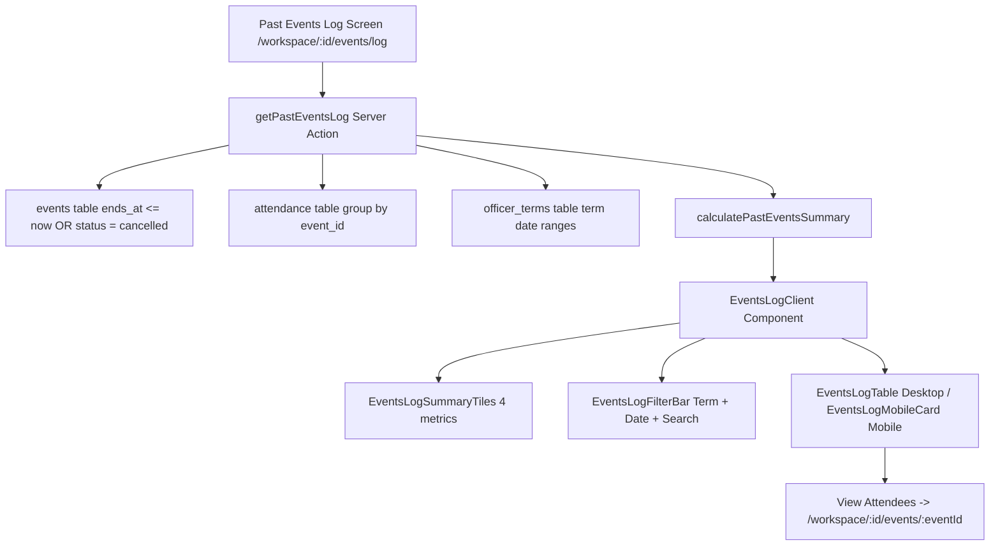

# Ticket H3: Auto-Build Past Events Log

## Overview
Ticket H3 introduces an automated past events log for student organizations in OrgKit. Rather than requiring officers to compile handover reports or hunt through past records, the log automatically queries concluded and cancelled events alongside their recorded attendance figures (from tickets E1, E3, and E4). Incoming and current officers can view the org's historical operational track record, filter by academic terms (ticket H1) or custom date ranges, and navigate directly into recorded attendee rosters.

---

## Acceptance Criteria

1. **Given events have ended**, when I open the log (`/workspace/:id/events/log`), then I see each past event with its date, location, and attendance count.
2. **Given I filter by term (from H1) or date range**, when I apply it, then only events in that range are shown.
3. **Given I select an event**, when it opens, then I see its attendee list as recorded (`/workspace/:id/events/:eventId`).
4. **Given an event was cancelled**, when I open the log, then it is shown as cancelled and has no attendance count.
5. **Error or edge case handled**: events with zero attendance show 0 and don't break totals or average calculations.
6. **Works on a 360px-wide phone**: fully responsive mobile card layout with touch-accessible buttons and stacked filters.

---

## Architecture & Data Flow

### 1. Database & Zero-Migration Approach
- Relies on existing Postgres tables:
  - `public.events`: `id, org_id, title, starts_at, ends_at, location, status, created_at`
  - `public.attendance`: `id, org_id, event_id, member_id, method, checked_in_at`
  - `public.officer_terms`: `id, org_id, term_name, start_date, end_date`
- No destructive migrations or manual report tables required; the log is auto-built purely on demand.

### 2. Multi-Tenant Authorization & Security
- The server action `getPastEventsLog(orgId)` wraps execution in `withOrgCaller(orgId, ...)`.
- Verifies that the caller has an active session and is an officer in `org_officers` for the requested organization.
- Students and officers of other organizations are denied access.

### 3. Edge Cases & Calculations
- **Cancelled Events**: Cancelled events are highlighted with a `Cancelled` pill badge; their attendance count is displayed as `null` / `—`, and they are omitted from total attendance sums and average calculations.
- **Zero Attendance**: Completed events with 0 recorded attendees cleanly display `0 attended` and do not cause division-by-zero errors in the summary calculations.
- **Term Range Mapping**: Integrates directly with H1 officer terms, allowing one-click filtering for an entire leadership year.
- **Dynamic Summaries**: When filters are applied (by term, date range, or keyword search), summary statistics (Total events, Completed, Total attendance, Average attendance) dynamically recalculate over the matching subset.

---

## UI & Design Specifications

- Complies with `docs/design.md`:
  - **Background Decor**: `FloatingIconsDecor` placed behind the summary tiles and cards.
  - **Fluid Typography**: Heading `fontSize: clamp(26px, 2.6vw, 34px)`, `lineHeight: 1.15`, `letterSpacing: -0.025em`, standardized across `Documents`, `Events`, and `Terms`.
  - **Pill Buttons**: `borderRadius: 9999` for all actions and filter reset triggers.
  - **Mobile 360px Viewport**: Responsive media query switching from desktop table to stacked mobile cards with touch targets >= 44px.
