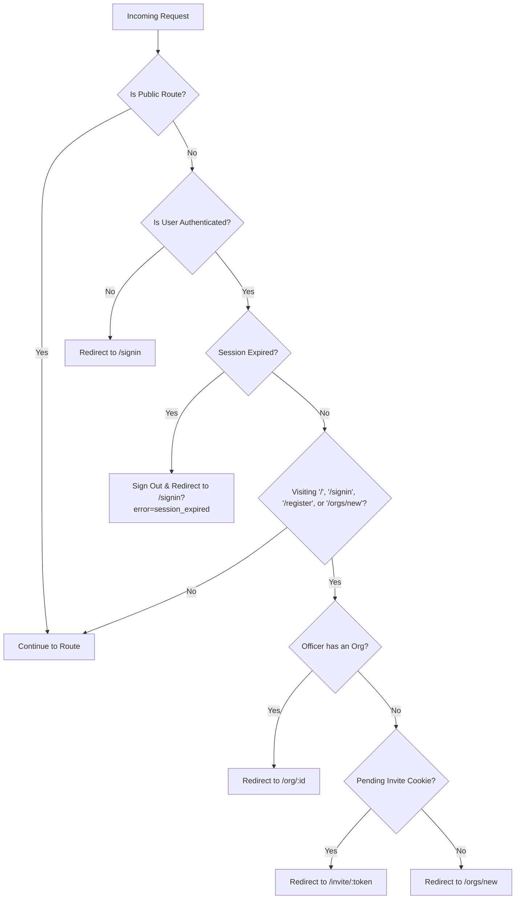

# OrgKit Route Reference (`routes.md`)

This document defines the complete routing architecture, page hierarchy, middleware rules, access control, and rewrite configurations for the **OrgKit** web application.

---

## 1. Routing Overview & Architecture

OrgKit is built using **Next.js App Router** with TypeScript and Supabase. The routing is partitioned into four primary zones:
1. **Public Marketing & Auth Routes:** Landing, sign-in, sign-up, and legal policies.
2. **Onboarding & Consent Routes:** First-time officer consent agreement.
3. **Authenticated Workspace Routes:** Organization home, officer administration, and member join management.
4. **Public Intake & Invitation Links:** Officer invite acceptance and student member link/QR intake.

---

## 2. Route Directory Map

| Route Path | Type | Access Level | Description |
| :--- | :---: | :---: | :--- |
| `/` | Page | Public | Landing page; redirects authenticated officers to their workspace or onboarding. |
| `/signin` | Page | Public | Officer sign-in with Google OAuth. |
| `/register` | Page | Public | Officer sign-up with Google OAuth. |
| `/setup` | Page | Public | Fallback setup screen. |
| `/privacy` | Page | Public | OrgKit Privacy Notice. |
| `/terms` | Page | Public | OrgKit Terms of Service. |
| `/auth/callback` | API Handler | Public | Supabase OAuth callback; completes session exchange & redirects. |
| `/consent` | Page | Authenticated Officer | First-time sign-in consent agreement before accessing workspaces. |
| `/orgs/new` | Page | Authenticated Officer | Create a new organization workspace (enforces 1 org per officer). |
| `/org/[id]` | Page | Authenticated Member | Workspace dashboard (also accessible via `/workspace/[id]`). |
| `/workspace/[id]` | Rewrite | Authenticated Member | Rewrite alias to `/org/[id]`. |
| `/workspace/[id]/officers` | Page | Authenticated Member | Officer management dashboard (Ticket A3; also aliased as `/org/[id]/officers`). |
| `/org/[id]/members/join` | Page | Admin Officer Only | Admin member intake panel with join link & QR code (Ticket A4). |
| `/invite/[token]` | Page | Public / Invitee | Officer invite link acceptance screen (Ticket A3). |
| `/invite/[token]/start` | API Handler | Public / Invitee | Starts OAuth flow with invite context. |
| `/join/[token]` | Page | Public / Students | Student member intake page via link or QR code (Ticket A4). |

---

## 3. Route Details & Specifications

### 3.1 Public Marketing & Authentication

#### `/` — Landing Page
- **File:** `src/app/page.tsx`
- **Auth:** Public
- **Behavior:**
  - Displays product marketing and entry CTAs.
  - If a signed-in officer visits `/`, middleware automatically redirects them:
    - To their workspace (`/org/[id]`) if they belong to an organization.
    - To `/invite/[token]` if they have an active pending invite cookie.
    - To `/orgs/new` if they have no organization assigned.

#### `/signin` & `/register` — Authentication
- **Files:** `src/app/signin/page.tsx`, `src/app/register/page.tsx`
- **Auth:** Public
- **Behavior:**
  - Standard OAuth entry points via Google.
  - Automatically redirects authenticated officers with an org to `/org/[id]`.

#### `/privacy` & `/terms` — Legal Notices
- **Files:** `src/app/privacy/page.tsx`, `src/app/terms/page.tsx`
- **Auth:** Public
- **Behavior:**
  - Static informative pages describing data collection, privacy commitments, and terms.
  - Linked from auth cards, consent forms, and public join pages.

---

### 3.2 Authentication & Onboarding

#### `/auth/callback` — OAuth Callback Handler
- **File:** `src/app/auth/callback/route.ts`
- **Method:** `GET`
- **Behavior:**
  - Receives the OAuth `code` from Google / Supabase Auth.
  - Exchanges the code for a persistent session.
  - Checks if the officer has recorded consent in `public.officers`:
    - If not: redirects to `/consent`.
    - If consent exists and an `orgkit_pending_invite` cookie is present: redirects to `/invite/[token]`.
    - If consent exists and user belongs to an org: redirects to `/org/[id]`.
    - If consent exists but user has no org: redirects to `/orgs/new`.

#### `/consent` — Officer Consent Agreement
- **File:** `src/app/consent/page.tsx`, `src/app/consent/consent-form.tsx`
- **Auth:** Authenticated User (Supabase Auth session required)
- **Behavior:**
  - Explains the personal data collected from Google (name and email).
  - Submitting inserts a record into `public.officers` (`consent_version`, `consent_at = now()`).
  - Upon completion, routes to pending invite if present, or `/orgs/new`.

---

### 3.3 Workspace & Organization Management

#### `/orgs/new` — Workspace Creation
- **File:** `src/app/(workspace)/orgs/new/page.tsx`
- **Auth:** Authenticated Officer with consent
- **Behavior:**
  - Form to input organization name and school.
  - Calls PostgreSQL `create_organization(org_name, org_school)`.
  - Creator is automatically assigned role `admin`.
  - Enforces the 1-org-per-officer constraint in v0.2.

#### `/org/[id]` (Alias: `/workspace/[id]`) — Workspace Dashboard
- **File:** `src/app/(workspace)/org/[id]/page.tsx`
- **Auth:** Authenticated Officer belonging to `org_id`
- **Behavior:**
  - Workspace home showing organization initials, name, school, navigation sidebar, and quick actions.
  - RLS ensures officers can only view data from their own organization.

#### `/workspace/[id]/officers` (Alias: `/org/[id]/officers`) — Officer Management (Ticket A3)
- **File:** `src/app/(workspace)/workspace/[id]/officers/page.tsx`
- **Auth:** Authenticated Officer belonging to `org_id`
- **Behavior:**
  - **All Officers:** Can view active officer list (names and roles).
  - **Admins Only:**
    - View officer email addresses and pending invites.
    - Open "Invite an officer" modal to generate a single-use 7-day invite link (stored as SHA-256 hash).
    - Revoke pending invites.
    - Change officer roles (`admin`, `finance`, `officer`) with atomic last-admin safeguard.
    - Remove officers with atomic last-admin safeguard.
  - **Non-Admins:** Email addresses and administrative action buttons are hidden; direct server actions are rejected on the server.

#### `/org/[id]/members/join` — Member Intake Panel (Ticket A4)
- **File:** `src/app/(workspace)/org/[id]/members/join/page.tsx`
- **Auth:** Admin Officer of `org_id` Only
- **Behavior:**
  - Server-side guard checks `is_org_admin(org_id)`; returns 404 (`notFound()`) for non-admins.
  - Displays the active public join link and live generated QR code.
  - Allows the admin to copy the join URL or download the QR code PNG image.
  - Allows the admin to toggle the link off or regenerate a fresh token.

---

### 3.4 Public Intake & Invitation Links

#### `/invite/[token]` — Accept Officer Invite (Ticket A3)
- **File:** `src/app/invite/[token]/page.tsx`, `src/app/invite/[token]/invite-client.tsx`
- **Auth:** Public / Google Sign-In
- **Behavior:**
  - Validates the token against SHA-256 hash in `org_invites`.
  - If invalid, expired (7 days), used, or revoked: displays `"This invite is no longer valid. Ask an admin to send a new one."`
  - If visitor is a guest: stores token in cookie (`orgkit_pending_invite`) and prompts Google sign-in.
  - If signed in with matching Google email: joins organization with assigned role and redirects to workspace.
  - If signed in with a mismatched email: shows mismatch screen with "Sign out and use a different account" without leaking the invited email address.

#### `/join/[token]` — Student Member Join via Link or QR (Ticket A4)
- **File:** `src/app/join/[token]/page.tsx`, `src/app/join/[token]/join-form.tsx`
- **Auth:** Public (Students do not create accounts or sign in)
- **Security Headers:**
  - `Referrer-Policy: no-referrer`
  - `X-Robots-Tag: noindex, nofollow`
- **Behavior:**
  - Looks up the active token via `get_join_org(token)`; reveals only the organization name.
  - If token is deactivated or replaced, shows `"This link isn't active. Ask your org's officers for a new one."`
  - Displays intake form: Full Name, Email, bilingual Consent Agreement (English/Filipino), 18+ checkbox, and Privacy Notice link.
  - Rate limited to 10 attempts per minute per device IP hash.
  - Submissions are saved as `status = 'pending'` for officer confirmation.
  - Duplicate join with the same email (case-insensitive) creates only one record and displays the identical thank-you screen to prevent membership enumeration.

---

## 4. Middleware & Proxy Rules (`src/proxy.ts`)

OrgKit routes all requests through `src/proxy.ts` (Next.js middleware):

### Public Path Whitelist
The following paths bypass authentication checks in middleware:
- `/`
- `/signin`
- `/register`
- `/privacy`
- `/terms`
- `/auth/*`
- `/join/*`
- `/invite/*`

### Cookie Management in Middleware
- **`orgkit_pending_invite`:** Set when an invitee opens `/invite/[token]` as a guest; ensures auth callback prioritizes invite acceptance over `/orgs/new`. Deleted automatically when visiting `/workspace/*`.

---

## 5. Next.js Route Rewrites (`next.config.ts`)

OrgKit uses URL rewrites to provide clean, RESTful workspace URLs:

| Incoming Request Path | Internal Destination Path | Purpose |
| :--- | :--- | :--- |
| `/workspace/:id` | `/org/:id` | Maps user-facing `/workspace/:id` to internal `/org/:id` handler. |
| `/org/:id/officers` | `/workspace/:id/officers` | Maps `/org/:id/officers` to internal `/workspace/:id/officers` page. |

---

## 6. Access Control & Role Matrix

| Route | Guest / Public | Member / Officer | Finance Role | Admin Role |
| :--- | :---: | :---: | :---: | :---: |
| `/` | ✅ View | 🔄 Redirect to Org | 🔄 Redirect to Org | 🔄 Redirect to Org |
| `/signin`, `/register` | ✅ View | 🔄 Redirect to Org | 🔄 Redirect to Org | 🔄 Redirect to Org |
| `/privacy`, `/terms` | ✅ View | ✅ View | ✅ View | ✅ View |
| `/consent` | ❌ Auth Req | ✅ If no consent | ✅ If no consent | ✅ If no consent |
| `/orgs/new` | ❌ Auth Req | ❌ (1 org limit) | ❌ (1 org limit) | ❌ (1 org limit) |
| `/org/[id]` | ❌ Auth Req | ✅ Own Org Only | ✅ Own Org Only | ✅ Own Org Only |
| `/workspace/[id]/officers` | ❌ Auth Req | 👁️ Read-Only | 👁️ Read-Only | ✏️ Full Admin Access |
| `/org/[id]/members/join` | ❌ Auth Req | 🚫 404 Not Found | 🚫 404 Not Found | ✏️ Full Admin Access |
| `/invite/[token]` | ✅ View & Join | 🔄 Join / Mismatch | 🔄 Join / Mismatch | 🔄 Join / Mismatch |
| `/join/[token]` | ✅ View & Submit | ✅ View & Submit | ✅ View & Submit | ✅ View & Submit |

